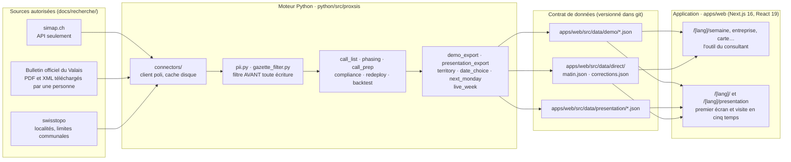

# Architecture

Proxsis tient en deux parties qui ne se parlent que par des fichiers : un **moteur Python** (`python/`, paquet
`proxsis`) qui lit les sources publiques, filtre les données personnelles, calcule et exporte ; une **application
web** (`apps/web/`, Next.js) qui lit ces fichiers, figés au moment de la construction. Aucune page n'appelle le moteur
ni une source externe pendant la démonstration. Décision d'origine : [ADR-0001](adr/0001-architecture.md).

## Moteur Python (`python/src/proxsis`)

Entrée unique : `proxsis <commande>` (`cli.py` construit l'analyseur ; chaque commande vit dans
`commands/` : `demo.py`, `collection.py`, `week1.py`, `gazette.py`, et les lecteurs partagés dans `io.py`).

| Groupe | Modules | Rôle |
|---|---|---|
| Accès aux sources | `http.py`, `connectors/` (`simap`, `swisstopo_*`, `zefix`, `geoadmin`, `amtsblatt`), `netcheck.py`, `catalogue_check.py` | client HTTP poli (cache disque, rejeu hors ligne, débit limité), un connecteur par source autorisée ; aucune source hors du catalogue ; `zefix`, `geoadmin` et `amtsblatt` attendent les accès demandés (`docs/demandes/`) : seuls leurs tests les appellent aujourd'hui |
| Données personnelles | `pii.py`, `gazette_filter.py`, `provenance.py` | filtre appliqué à chaque enregistrement **avant** toute écriture ; provenance de chaque ligne (source, date, licence) |
| Bulletin officiel | `gazette_pdf.py`, `gazette_xml.py`, `gazette_import.py` | lecture des exports PDF et XML qu'une personne a téléchargés (le portail reste en consultation humaine) |
| Calcul de la semaine | `call_list.py`, `specialty.py`, `phasing.py`, `call_prep.py`, `compliance.py`, `cct.py`, `redeploy.py`, `proposals.py`, `validation_sheet.py`, `live_week.py` | liste d'appels par spécialité, besoins estimés par phase, guide d'appel sourcé, obligation d'annonce, fins de mission |
| Modèles et mesures | `models/` (M0 à M6), `features.py`, `targets.py`, `metrics.py`, `backtest.py`, `real_backtest.py`, `suite.py`, `fairness.py`, `report.py`, `model_reports.py` | backtests « vu à la date T » ; chaque chiffre publié renvoie à une ligne de `CLAIMS.md` |
| Monde fictif | `synth/` (`world.py`, `candidates.py`, `geo.py`, `store.py`) | consultants, intérimaires et agences de démonstration, tous marqués fictifs |
| Collecte et annotation | `manual_collection*.py`, `annotation_*.py`, `real_testset.py`, `real_entities.py`, `compare_extractors.py`, `m6_real.py`, `simap_overview.py` | sessions sur le Mac de Hiba ; les textes bruts restent hors de git |
| Exports | `demo_export.py`, `presentation_export.py`, `presentation_stories.py`, `territory.py`, `date_choice.py`, `next_monday.py`, `docs_week1.py` | fichiers lus par l'application et la visite (territoire de la carte, lundis de « Choisissez une date », lundi suivant), documents régénérables |
| IA | `llm/` | interface de fournisseur ; tout fonctionne avec le faux fournisseur déterministe ; la clé n'est jamais écrite |

## Contrat de données

Les fichiers de `apps/web/src/data/` sont produits par le moteur (`proxsis export-demo`, `export-presentation`,
`histoires-presentation`, `territoire-presentation`, `lundis-presentation`, `lundi-suivant-presentation`,
`matins-presentation`, `moments-presentation`, `contours-communes`, `carte-sources`, `matin-en-direct`) et commités ;
`src/data/equipe/equipe.json` est écrit à la main, et `src/data/presentation/presentation.json` ne sert plus qu'à
`contours-communes` et au test des schémas. L'application les importe au moment de la construction :
la démonstration fonctionne hors ligne par construction.

- `src/lib/schema.ts` décrit chaque fichier (schémas zod) ; `schema.test.ts` valide les onze fichiers de la démo et
  vérifie à la compilation que ce qu'accepte un schéma correspond au type lu par les écrans (`src/lib/types.ts`).
- Une seule date de démonstration : le lundi de la liste (`meta.semaine`). Aucun écran ne lit l'horloge
  (`src/lib/clock.test.ts`), donc l'affichage est le même dans deux jours et dans trois semaines.
- `data/direct/matin.json` (« Chaque matin, en direct de simap » : le lundi la semaine écoulée, du mardi au vendredi
  la veille) et `data/direct/corrections.json` (rectifications publiées par simap pour un avis des données figées,
  dites à côté de l'avis) sont réécrits ensemble chaque jour ouvrable par le workflow
  `.github/workflows/chaque-matin-en-direct.yml`, seulement si tous les contrôles et tests passent (règle des 8 h des
  conditions de simap vérifiée) ; ce workflow ne tourne que depuis la branche par défaut, et seulement une fois la
  variable du dépôt `CHAQUE_MATIN_EN_DIRECT` posée par Hiba (ADR-0016). Les données figées, la liste du lundi et
  `CLAIMS.md` ne changent jamais avec eux. `data/presentation/matins.json` en est la version figée, pour chaque lundi
  de « Choisissez une date ».

## Application web (`apps/web/src`)

| Dossier | Contenu |
|---|---|
| `app/(accueil)` | la racine `/`, qui ouvre l'allemand si le navigateur le préfère, le français sinon |
| `app/[lang]/(futur)/` | l'outil du consultant : `semaine/[consultant]`, `entreprise/[id]` (`appel`, `candidats`), `agence/[agence]`, `carte`, `conformite`, `redeploiement`, `roi`, `mesures` |
| `app/[lang]/page.tsx`, `app/[lang]/une-page/` | le premier écran (moins de 1 Mo) et « Proxsis en une page » (imprimable) |
| `app/[lang]/presentation/` | la visite en cinq temps (`visite/Visit.tsx`, huit étapes), ses notes (mode présentateur), la synthèse imprimable, « Vos questions », « Qui sommes-nous », « Pour vos équipes techniques », « Pour votre direction », la feuille de route, le dossier de preuves et la démo au téléphone |
| `visite/` | la visite : état et étapes (`state.ts`, clé locale `proxsis.visite.v1`), scènes (carte, dossier, carnet, lundi suivant, seuil, pilote, conclusion), textes FR et DE (`copy.ts`, `pages.ts`, `notes.ts`), données (`data.ts`, `firstTest.ts`) |
| `futur/` | composants et feuille de style de l'outil (`futur.css`) |
| `presentation/` | ce que la visite reprend de l'ancienne présentation en sept actes (retirée) : « Choisissez une date » (`ChooseDate.tsx`), le dossier de preuves et ses histoires (`Proofs.tsx`, `Stories.tsx`), le cadre (`direction.css`, `ui.tsx`, `Frame.tsx`), leurs textes (`copy.ts`, `copy_c.ts`), les données des lundis et des histoires, la démo au téléphone (`phone/`) |
| `components/` | sélecteur de rôle, enveloppes |
| `lib/` | lecture des données (`data.ts`, côté serveur seulement), schémas, types, formats (`digits.ts`, `i18n.ts`, `amount.ts`), carnet (`carnet.ts`, `carnetStore.ts`, clé locale `proxsis.carnet.v1`), seuil (`seuil.ts`), rectifications simap (`corrections.ts`), conservation sur l'appareil avec repli en mémoire (`useStored.ts`) |
| `i18n/` | textes de l'outil en français et en allemand (`dictionaries.ts`) |

Chaque texte affiché existe en français et en allemand (`i18n/textes.test.ts`). Les en-têtes de sécurité (politique
de contenu limitée au site lui-même) sont posés par `next.config.ts` pour la version servie.

## Réseau pendant la démonstration

Aucun appel sortant : les données sont dans le paquet construit, et les saisies (choix de la visite, carnet, mode
essai) restent dans le navigateur, sur l'appareil, jamais envoyées. La base `supabase/` (retours d'appel) n'est plus
appelée par aucune page depuis le carnet. Les liens vers simap.ch ne sont suivis que si quelqu'un clique.
`e2e/reseau.spec.ts` vérifie qu'aucune requête ne quitte le site.

## Fichiers de plus de 400 lignes

Règle : pas de fichier de plus de 400 lignes sans raison écrite. `cli.py` (1 277 lignes) et `gazette_pdf.py` (885) ont
été découpés en phase 2 ; les fichiers ci-dessous restent longs pour la raison indiquée.

| Fichier | Lignes | Raison |
|---|---|---|
| `apps/web/src/i18n/dictionaries.ts` | 1 006 | textes, pas de logique : les deux langues côte à côte, clé par clé, pour que le test de parité FR/DE et la relecture allemande portent sur un seul fichier |
| `apps/web/src/visite/copy.ts` | 706 | textes de la visite, les deux langues côte à côte, même raison que les dictionnaires |
| `python/src/proxsis/synth/world.py` | 664 | générateur du monde fictif : une seule graine, un seul ordre de tirage ; le découper risquerait de changer l'ordre des tirages et donc le monde de référence de tous les backtests |
| `python/src/proxsis/presentation_stories.py` | 602 | les trois histoires de l'acte 4 et leur écran de mesure, avec le contrôle que rien de postérieur à la date T ne fuit dans ce qui était connu ce jour-là ; une seule chaîne, testée de bout en bout |
| `python/src/proxsis/annotation_page.py` | 555 | environ 420 lignes sont le gabarit HTML de la page d'annotation (sans serveur ni réseau), gardé en un seul fichier pour qu'elle s'ouvre telle quelle |
| `python/src/proxsis/gazette_filter.py` | 545 | le filtre des données personnelles du Bulletin officiel, gardé en un seul module pour être relu d'un seul tenant |
| `python/src/proxsis/connectors/swisstopo_boundaries.py` | 533 | une chaîne unique : téléchargement, lecture du shapefile, simplification qui garde les frontières communes, projection |
| `python/src/proxsis/call_list.py` | 480 | le calcul de la liste d'appels, cœur du produit ; découpage reporté tant que la liste de la semaine 1 est gelée |
| `python/src/proxsis/cli.py` | 464 | l'analyseur de toutes les commandes, une ligne par option ; le code des commandes vit dans `commands/` |
| `python/src/proxsis/docs_week1.py` | 461 | gabarits des quatre documents de la semaine 1, régénérés par une commande (chaque chiffre sort d'une commande) |
| `python/src/proxsis/connectors/simap.py` | 448 | le connecteur simap entier (recherche, normalisation, filtre, mention obligatoire), relu comme un tout pour respecter les conditions de l'API |
| `apps/web/src/visite/visite.css` | 438 | feuille de style de la visite, organisée par temps |
| `apps/web/src/visite/Visit.tsx` | 428 | la visite : ses temps et ses étapes, la navigation et ses raccourcis, en un seul composant |
| `apps/web/src/presentation/phone/pilot.ts` | 409 | pilote de la démo au téléphone (une classe, une machine à états) |
| `apps/web/src/futur/futur.css` | 408 | feuille de style de l'outil du consultant |
| `python/src/proxsis/commands/demo.py` | 406 | les commandes d'export de la démonstration et de la visite, qui partagent leurs lecteurs |
